<div align="center">

<picture>
  <source media="(prefers-color-scheme: dark)" srcset="docs/assets/hero-dark.svg">
  
</picture>

<br>

[](CHANGELOG.md) [](LICENSE) [](https://www.w3.org/TR/webgpu/) [](https://aztech-lab.github.io/OTSR/) [](https://github.com/Aztech-Lab/OTSR/commits/main)

### [▶&nbsp; Open OTSR — aztech-lab.github.io/OTSR](https://aztech-lab.github.io/OTSR/)

**[Technical report](https://aztech-lab.github.io/OTSR/report.html)** · **[Getting started](docs/getting-started.md)** · **[The method](docs/method.md)** · **[Changelog](CHANGELOG.md)** · **[Cite](CITATION.md)**

</div>

## What it is

OTSR turns a raster image into a mesh of anisotropic 2-D Gaussians laid out by optimal transport, then renders that
vector model at **any** resolution. Nothing leaves your machine: the initialisation, the gradient fit, the viewer and
the export all run on your own GPU through [WebGPU](https://www.w3.org/TR/webgpu/). No server, no upload, no neural
network weights. A 2048 × 2048 anime frame becomes 419 k Gaussians in about 6 s on an RTX 4090 and can then be viewed
or exported at 2×, 4×, 8× … with edges as sharp as the original.

The method is from our workshop paper on placing Gaussians by optimal transport (see [CITATION.md](CITATION.md)); this
repository is its self-contained, browser-side implementation, by [Aztech Labs](https://github.com/Aztech-Lab).

## How it works

<picture>
  <source media="(prefers-color-scheme: dark)" srcset="docs/assets/pipeline-dark.svg">
  
</picture>

1. **Optimal-transport initialisation** — an edge-importance density of the image is computed, an entropic OT map
   (Sinkhorn, on the GPU) moves a uniform mesh onto it, and every mesh cell, deformed by the map's Jacobian,
   becomes one Gaussian: dense and elongated along edges, sparse and round in flat regions.
2. **Fitting** — Adam on all 9 parameters of every Gaussian (position, two log-scales, rotation, colour, log-weight)
   against the image, with the exact gradients of the weighted-normalised Gaussian blend; 3000 steps by default.
3. **Resolution-independent rendering** — the model is a continuous function; the viewer evaluates it at any zoom and
   the exporter at any scale, tile by tile.
4. **Distance-field edges** — at magnification the Gaussian render goes through the trick that keeps vector fonts
   sharp (Green, SIGGRAPH 2007): a locally normalised luminance field is re-thresholded with a transition a fixed
   number of *output* pixels wide, so edges stay crisp at 8× while gradients and shading are untouched.

The full derivation is in [docs/method.md](docs/method.md), the engine in [docs/engine.md](docs/engine.md), and the
**[technical report](https://aztech-lab.github.io/OTSR/report.html)** tells the whole story the way a magazine would,
with nine demonstrations that run live in the page.

## What it looks like


<sub>The bundled sample at 4×, as the app's split view shows it: bicubic on the left, OTSR with the edge pass on the
right. Standard tier, 83.6 k Gaussians, 48.6 dB against the source.</sub>

<table>
<tr>
<td width="50%" valign="top">

**On a computer**

The console on the left holds the source, the tier and the output scale; Enhance sits at the top. While a fit runs
the stage plays the real process: the OT mesh settling on the image through every Sinkhorn stage, the Gaussians
growing in their id colours, a scan line revealing the result, and a monitor following the three regions with the
strongest gradients. Then drag the divider against bicubic, zoom with the wheel, export at any scale.

</td>
<td width="50%" valign="top">

**On a phone**

The same engine. The tier lives in the menu of the Enhance button (phones start on Fast; Turbo is about 4× quicker
and skips the show), a strip under it shows the source, its cost and the state, and the console is a sheet at the
bottom. Two fingers zoom. The start screen first checks the device: whether WebGPU works, the GPU and its limits,
the largest image one fit can take.

</td>
</tr>
<tr>
<td width="50%" valign="top">

**Research mode**

Every parameter (Gaussians per pixel, steps, edge width, L1 / L2 loss), the vector view with every Gaussian in its
own colour, the OT mesh, the 1σ outlines, the error map, the split against any resampler, the region tool and the
session information with the PSNR curve. Everything has a keyboard shortcut (press **?**) and every label is in
English and Traditional Chinese.

</td>
<td width="50%" valign="top">

**Files**

Export as PNG, JPEG, WebP, AVIF or BMP at 1×–16× or any scale. **Save .otsr** keeps the model itself, a few MB that
re-render at any size later with **Load .otsr**; the [format](docs/file-format.md) is documented and the Python
reference reads it too.

</td>
</tr>
</table>

## Try it

**[aztech-lab.github.io/OTSR](https://aztech-lab.github.io/OTSR/)** — open it in Chrome or Edge 113+ (Windows, macOS,
Linux, Android) or Safari 26+ (macOS, iOS), on a machine with a GPU. Integrated GPUs and phones work; a discrete GPU
is much faster. Then:

1. Press **Load sample**, or **Open image** / drop / paste an image of your own.
2. Pick a tier and press **Enhance**.
3. Compare, zoom, pan; the **View** menu switches the vector view, the OT mesh, the outlines and the error map.
4. **Export** at the scale you need, or **Save .otsr** to keep the model.

The four tiers on an RTX 4090 (the fit alone; the OT initialisation adds 0.1–0.5 s):

| Tier | Budget, steps | Sample, 1024 × 815 | Anime frame, 2048 × 2048 |
|---|---|---|---|
| Turbo | 1 Gaussian / 20 px, 400 | 0.11 s, 40.5 dB | 0.53 s, 49.0 dB |
| Fast | 1 / 20 px, 1500 | 0.53 s, 43.4 dB | 2.17 s, 50.1 dB |
| Standard | 1 / 10 px, 3000 | 0.99 s, 48.6 dB | 5.33 s, 52.8 dB |
| Best | 1 / 7 px, 4000 | 1.68 s, 51.2 dB | 8.76 s, 54.5 dB |

A 4× export of the 2048 × 2048 frame (8192 × 8192, with edges) takes 1.3 s. The memory model and more measurements
are in [docs/performance.md](docs/performance.md); details of the app in [docs/getting-started.md](docs/getting-started.md);
if WebGPU does not start, see [docs/troubleshooting.md](docs/troubleshooting.md) (dual-GPU laptops in particular).

## Run it yourself

Browsers do not run WebGPU modules from `file://`, so a release build has to be served over HTTP:

- Windows: double-click `serve.bat` (needs [Node.js](https://nodejs.org) 20+), or
- any OS: `node tools/serve.mjs`, or `python -m http.server -d dist 8787`, or any static web server.

To build from source:

```bash
npm install            # TypeScript, Vite, Vitest, Dawn's WebGPU for Node (tests), puppeteer-core (smoke test)
npm run dev            # live-reload dev server
npm run build          # type-check + production build into dist/ (+ docs)
npm test               # unit tests (CPU)
npm run test:gpu       # kernel tests on a real GPU in Node, against the Python reference
npm run smoke          # drives the real UI in headless Chrome (needs a build)
```

The Python reference (`reference/`) is the executable specification: it regenerates the golden test data with
`npm run golden` (PyTorch ≥ 2.0, CPU is enough). See [docs/development.md](docs/development.md) and
[docs/testing.md](docs/testing.md).

## Repository layout

```
index.html, src/app/      the web UI (viewer, panels, monitor, export); report.html, src/report.*: the technical report
src/engine/               the WebGPU engine: TypeScript orchestration + WGSL kernels (src/engine/shaders/)
src/core/                 CPU-side model code: constants, OT initialisation maths, the .otsr file format
reference/otsr_ref/       Python reference implementation (PyTorch, dense, float64-capable)
reference/upstream/       unmodified snapshot of the research code the reference was derived from
tests/unit, tests/gpu     Vitest suites; tests/golden holds the reference outputs they check against
tools/                    serve, smoke test, benchmark, WebGPU probes, the README figures
public/samples/           the bundled sample image
docs/                     documentation (method, engine, file format, testing, performance, troubleshooting)
```

## Versions

| Version | What it brought |
|---|---|
| **0.1.4** | **Phones, part two**: a **Turbo** tier (about 4× quicker than Fast, no fit animation) and Fast by default on phones; the tier in the split menu of the Enhance button, with the source, its cost and the state in a strip under it; a **system check** on the start screen (WebGPU, the GPU and its limits, the largest image one fit can take); the state in the status strip and a clearer mode switch; a fit animation that no longer slows the fit. The **technical report** rewritten as a magazine would tell it: the pipeline run live under Figure A, nine live demonstrations, a reading list of 45 entries; *mesh* instead of *lattice* throughout. |
| **0.1.3** | **Phones**: a bottom-sheet layout with pinch zoom, a column layout sideways; the **technical report** page; the mode switch in the console's title bar and a console that keeps its width; less work per frame. |
| **0.1.2** | The extras and the **vector view**: the model in Gaussian-id colours, the fit animation (OT mesh → Gaussians → scan reveal), the monitor panel, the View menu (vector / OT mesh / outlines / error map), export as PNG / JPEG / WebP / AVIF / BMP, a process log, notices in the status strip, bilingual labels, starlight and geometry on the stage, the way back to the start screen. |
| **0.1.1** | **Research mode**: custom budget and steps, edge width, L1 / L2 loss, view modes and split against any resampler, 1σ outlines, error map, region tool, session info with the PSNR curve. |
| **0.1.0** | First public version: the WebGPU engine and the UI in the lab-white / copper design, the `.otsr` format, the Python reference and the golden tests. |

Details per version are in [CHANGELOG.md](CHANGELOG.md).

## Documentation

[docs/index.md](docs/index.md) — getting started, the method, the engine, the `.otsr` format, testing,
development, performance, troubleshooting — and [docs/tutorial-porting.md](docs/tutorial-porting.md), the
step-by-step record of how the research code was turned into this engine (derivations, decisions, pitfalls).

## Also from Aztech Labs

The OTSR design — lab white or near-black, a copper signal, cut corners, monospaced labels — is also a skin of
[CloudCLI-MobileUI](https://github.com/Aztech-Lab/CloudCLI-MobileUI), our phone-friendly web interface for Claude
Code. The figures in this README are drawn in the same design (`tools/readme-figures.py`).

## Acknowledgements

OTSR is built and maintained by [Aztech Labs](https://github.com/Aztech-Lab); the sample image is our own work (AI-generated art).
The WebGPU trainer of [SAD (Soft Anisotropic Diagrams)](https://github.com/luckyiyi/SAD) was a helpful reference for
structuring a browser-side fitting loop; the GPU tests run on [Dawn's Node bindings](https://github.com/dawn-gpu/node-webgpu).

## License

MIT — see [LICENSE](LICENSE).
